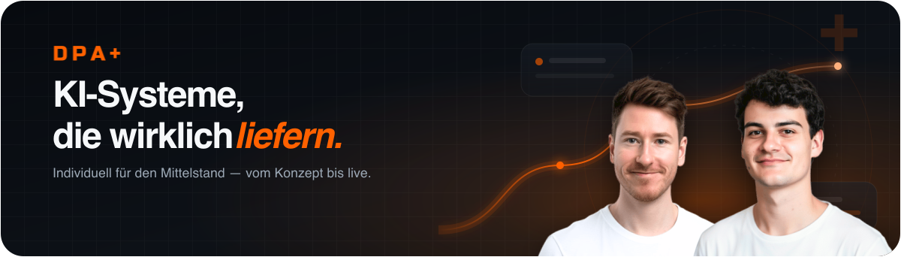

  

  <a href="https://dpa.plus/?utm_source=github&amp;utm_medium=org_profile&amp;utm_campaign=profile"><strong>Website</strong></a>
  &nbsp;·&nbsp;
  <a href="https://dpa.plus/referenzen/?utm_source=github&amp;utm_medium=org_profile&amp;utm_campaign=profile"><strong>Referenzen</strong></a>
  &nbsp;·&nbsp;
  <a href="https://check.dpa.plus/?utm_source=github&amp;utm_medium=org_profile&amp;utm_campaign=profile"><strong>Kostenloser KI-Check</strong></a>
  &nbsp;·&nbsp;
  <a href="https://join.dpa.plus/?utm_source=github&amp;utm_medium=org_profile&amp;utm_campaign=profile"><strong>Karriere</strong></a>
  &nbsp;·&nbsp;
  <a href="https://dpa.plus/kontakt/?termin=analyse&amp;utm_source=github&amp;utm_medium=org_profile&amp;utm_campaign=profile"><strong>Analyse-Termin</strong></a>

## Aus deinen Tools wird ein System.

DPA+ baut individuelle Software und KI-Systeme für inhabergeführte Mittelständler. Wir verbinden bestehende Tools, Daten und Abläufe zu einem System, mit dem das Team jeden Tag arbeiten kann — vom ersten Prozessgespräch bis zum laufenden Betrieb.

### Was wir bauen

- **Individuelle Software:** CRM, ERP, Kundenportale und interne Werkzeuge, die zum Betrieb passen.
- **KI-Systeme:** Automatisierung für Postfächer, Dokumente, Telefonie, Vertrieb und Wissensarbeit.
- **Schnittstellen und Betrieb:** Bestehende Software bleibt im Einsatz, Daten fließen automatisch und das System wird von uns weiter betreut.

### Was du hier findest

Auf GitHub veröffentlichen wir ausgewählte Plugins, Entwicklerwerkzeuge und Infrastruktur-Bausteine aus unserer täglichen Arbeit. Die Kundensysteme bleiben bewusst privat: Quellcode und Daten gehören unseren Kunden.

Mehr über die Ergebnisse unserer Arbeit steht in den [Case Studies](https://dpa.plus/referenzen/?utm_source=github&amp;utm_medium=org_profile&amp;utm_campaign=readme) — oder starte direkt den [kostenlosen KI-Sichtbarkeitscheck](https://check.dpa.plus/?utm_source=github&amp;utm_medium=org_profile&amp;utm_campaign=readme).
